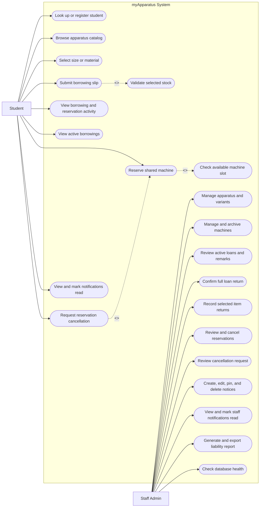
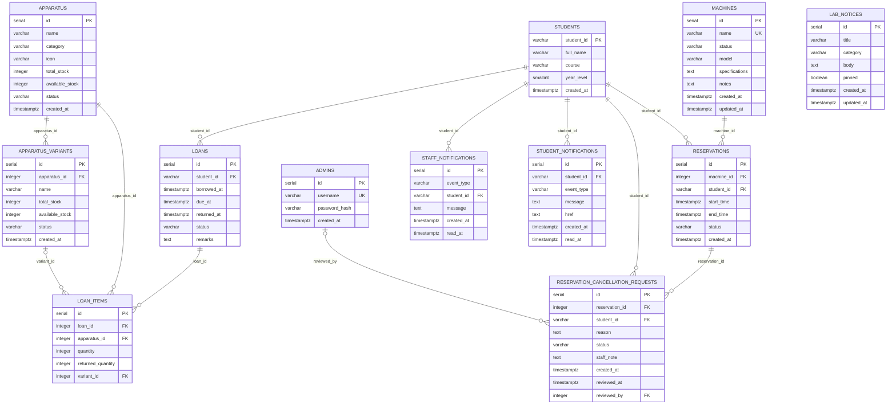
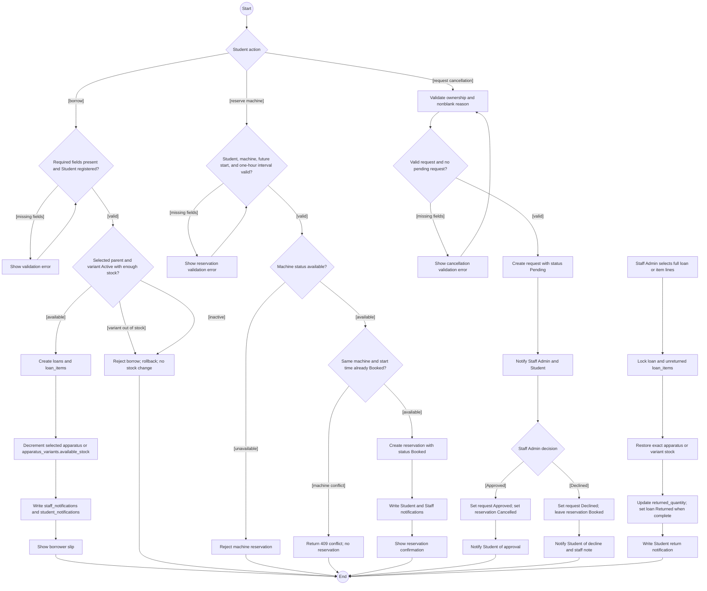
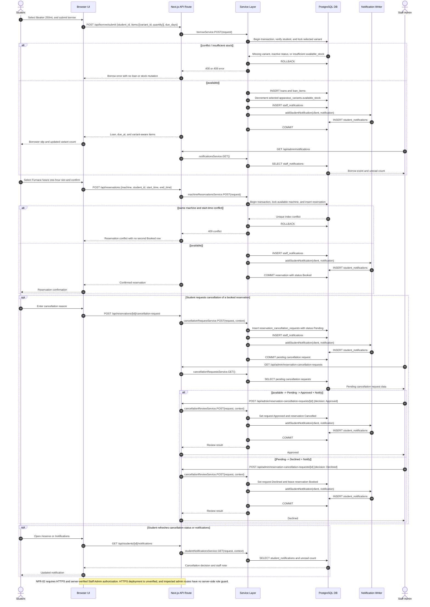
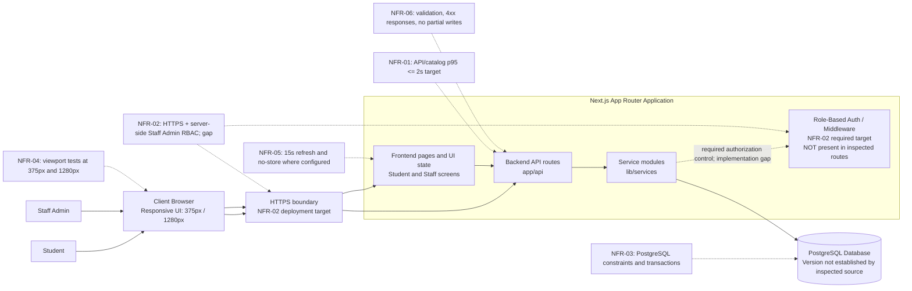
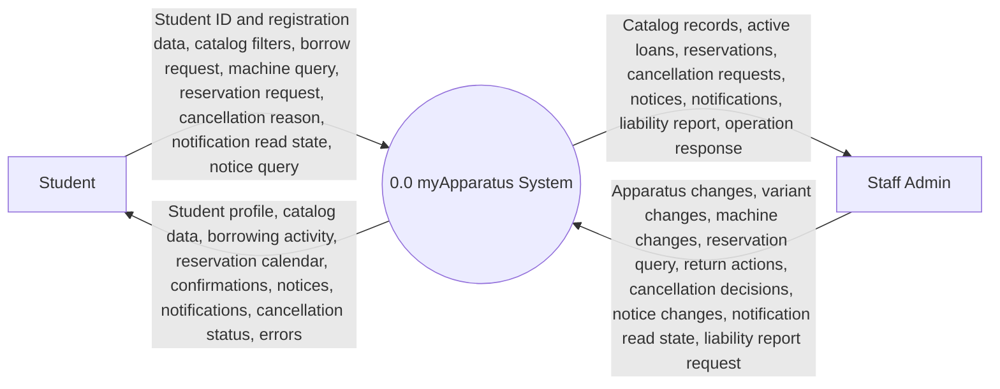
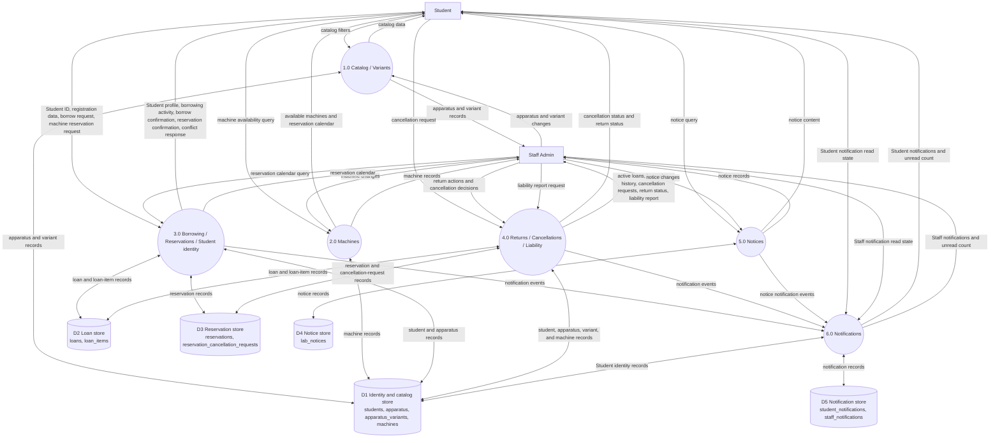
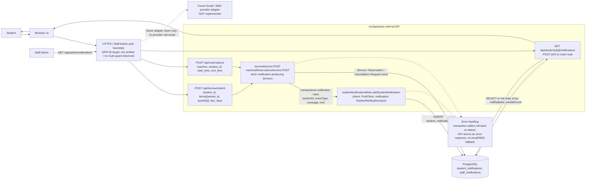
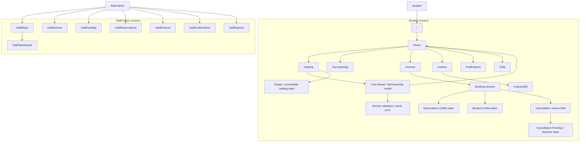

# Software Requirements Specification (SRS): myApparatus

## Part 1: Requirements Foundation & Traceability

### 1.1 Document basis and conformance notes

This part records the requirements supported by the implementation inspected in:

- `database/migrations/001_init.sql` through `007_add_apparatus_variants.sql`
- `database/seeds/001_seed.sql` through `005_apparatus_variants_seed.sql`
- `app/` pages and `app/api/` route handlers
- `lib/services/`
- `types/`

No mock-data modules, dependency files, generated output, CSS, deployment configuration, or files outside those source paths were used to establish the implementation baseline.

The functional requirements below describe observed behavior. Non-functional requirements that ask for performance, HTTPS, and role-based access control are measurable system targets, not claims that the current source already satisfies them. Source inspection found no server-side Staff Admin authorization guard on `/staff/*` or `/api/admin/*`; deployment HTTPS could not be established from the permitted files. The relevant acceptance tests are therefore explicit and should be treated as release gates.

### 1.2 System overview and actors

#### System purpose and boundary

myApparatus is a browser-based laboratory apparatus and shared-machine management application. Its observed boundary comprises:

1. A Next.js App Router UI under `app/`.
2. JSON API handlers under `app/api/`.
3. PostgreSQL access and transaction logic in `lib/services/`.
4. PostgreSQL schema, constraints, migrations, and seed records in `database/migrations/` and `database/seeds/`.

The application supports Student ID lookup/registration, apparatus borrowing, individually stocked apparatus variants, shared-machine reservations, reservation cancellation requests, loan return recording, staff remarks, lab notices, notifications, and a staff liability report. Apparatus are borrowed; the implemented reservation workflow is for shared machines, not apparatus reservations.

#### Roles

| Role | Implemented interaction |
|---|---|
| Student | Enters or scans a Student ID, can register a student record, browses apparatus and variant stock, submits a borrowing slip, views own borrowing/dashboard data, reserves a shared machine, requests cancellation of an owned reservation, reads notices, and manages notification read state. Student identity is represented by a `student_id` value supplied by the browser/API. |
| Staff Admin | Uses the staff-facing catalog, active-loan, return, reservation, cancellation-review, notice, notification, and liability-report pages. The UI calls `/api/admin/*` endpoints. The login page is labeled “Technician login.” |

#### Access-control boundary observed in source

The student UI stores a student record in browser `localStorage`; student API calls identify the student by `student_id`. The staff login page stores a `staff` object in `localStorage`; the inspected staff pages and API service methods do not establish or check a server-side staff session or role. The `admins` table exists in the schema, but the inspected API routes do not use it to authenticate requests. Thus “Student” and “Staff Admin” describe intended use, not a server-enforced authorization boundary in the current inspected implementation.

#### Application page routes

| Page route | Purpose |
|---|---|
| `/` | Student ID lookup/registration entry and link to staff login |
| `/home` | Student activity dashboard |
| `/catalog` | Apparatus catalog and borrowing |
| `/my-bookings` | Student active borrowing list and filters |
| `/reserve` | Shared-machine calendar and cancellation requests |
| `/notices` | Student lab-notice list, search, and category filter |
| `/notices/[id]` | Student lab-notice detail and previous/next navigation |
| `/notifications` | Student notifications and read state |
| `/help` | Student help and process information |
| `/staff/login` | Staff login UI |
| `/staff/dashboard` | Staff active loans, remarks, and full-loan return |
| `/staff/catalog` | Apparatus, variants, and machine management |
| `/staff/returns` | Student borrowing history and item-line returns |
| `/staff/reservations` | Staff reservation calendar, cancellation, and request review |
| `/staff/notices` | Lab-notice create, edit, pin, and delete |
| `/staff/notifications` | Staff event notifications and read state |
| `/staff/reports` | Overdue-liability report and CSV export |

#### API route inventory

The following inventory records the actual route/method pairs exposed by `app/api/`.

| Route | Methods | Observed purpose |
|---|---|---|
| `/api/health` | GET | Database-backed health response |
| `/api/students` | POST | Register a student |
| `/api/students/[id]` | GET | Find a student by Student ID |
| `/api/students/[id]/dashboard` | GET | Student overdue, due-soon, and upcoming-reservation activity |
| `/api/students/[id]/loans` | GET | Active, unreturned student loan items |
| `/api/students/[id]/notifications` | GET, POST | List notifications; mark one or all read |
| `/api/students/[id]/reservation-cancellation-requests` | GET | Student cancellation-request history |
| `/api/apparatus/list` | GET | Active apparatus catalog, nested variants, category/search filters |
| `/api/borrow/submit` | POST | Submit a borrowing slip |
| `/api/machines` | GET | List machines whose status is `available` |
| `/api/reservations` | GET, POST | Query booked machine slots; create a machine reservation |
| `/api/reservations/[id]/cancellation-request` | POST | Submit a student cancellation request |
| `/api/notices` | GET | List public lab notices |
| `/api/admin/apparatus` | GET, POST | List apparatus and variants; create apparatus |
| `/api/admin/apparatus/[id]` | PATCH | Edit apparatus or change its `Active`/`Inactive` status |
| `/api/admin/apparatus/[id]/variants/[variantId]` | PATCH | Edit one variant and its independent stock |
| `/api/admin/machines` | GET, POST | List or create machines |
| `/api/admin/machines/[id]` | PATCH | Edit a machine or change its status |
| `/api/admin/active-loans` | GET | List active, unreturned staff loans |
| `/api/admin/active-loans/[id]` | PATCH | Update active-loan remarks and/or eligible item variant selections |
| `/api/admin/active-loans/[id]/return` | POST | Return all remaining items on a loan |
| `/api/admin/returns` | GET, POST | Load student borrowing history; return selected loan-item lines |
| `/api/admin/reservations` | GET | Query booked reservations by date range and optional machine |
| `/api/admin/reservations/[id]` | DELETE | Cancel an active booked reservation |
| `/api/admin/reservation-cancellation-requests` | GET | List cancellation requests |
| `/api/admin/reservation-cancellation-requests/[id]` | POST | Approve or decline a cancellation request |
| `/api/admin/notices` | POST, PUT, DELETE | Create, update, and delete lab notices |
| `/api/admin/notifications` | GET, POST | List staff notifications; mark one or all read |
| `/api/admin/reports/liability` | GET | Query overdue unreturned items for the liability report |

### 1.3 Database foundation

#### Effective tables and columns

The following names and columns are defined across migrations 001–007. Migration 005 changes the effective `machines.status` values from the original values in migration 001.

| Table | Columns |
|---|---|
| `students` | `student_id`, `full_name`, `course`, `year_level`, `created_at` |
| `apparatus` | `id`, `name`, `category`, `icon`, `total_stock`, `available_stock`, `status`, `created_at` |
| `apparatus_variants` | `id`, `apparatus_id`, `name`, `total_stock`, `available_stock`, `status`, `created_at` |
| `loans` | `id`, `student_id`, `borrowed_at`, `due_at`, `returned_at`, `status`, `remarks` |
| `loan_items` | `id`, `loan_id`, `apparatus_id`, `quantity`, `returned_quantity`, `variant_id` |
| `machines` | `id`, `name`, `status`, `model`, `specifications`, `notes`, `created_at`, `updated_at` |
| `reservations` | `id`, `machine_id`, `student_id`, `start_time`, `end_time`, `status`, `created_at` |
| `admins` | `id`, `username`, `password_hash`, `created_at` |
| `reservation_cancellation_requests` | `id`, `reservation_id`, `student_id`, `reason`, `status`, `staff_note`, `created_at`, `reviewed_at`, `reviewed_by` |
| `staff_notifications` | `id`, `event_type`, `student_id`, `message`, `created_at`, `read_at` |
| `student_notifications` | `id`, `student_id`, `event_type`, `message`, `href`, `created_at`, `read_at` |
| `lab_notices` | `id`, `title`, `category`, `body`, `pinned`, `created_at`, `updated_at` |

Migration 001 also defines the `active_loans_view`, replaced by migration 007 to include variant labels. Its columns are `loan_id`, `student_id`, `full_name`, `items`, `borrowed_at`, `due_at`, and derived `status`.

#### Persisted status and category values

| Field | Persisted values / rule |
|---|---|
| `apparatus.status`, `apparatus_variants.status` | `Active`, `Inactive` |
| `machines.status` | `available`, `in_use`, `maintenance`, `archived` |
| `loans.status` | `Active`, `Returned`; the staff API derives the display status `Overdue` from an active loan whose `due_at` is before the current time |
| `reservations.status` | `Booked`, `Cancelled` |
| `reservation_cancellation_requests.status` | `Pending`, `Approved`, `Declined` |
| `lab_notices.category` | `Schedule`, `Safety`, `Announcements` |
| `staff_notifications.event_type` | `Borrow`, `Reservation`, `Cancellation Request` |
| `student_notifications.event_type` | `Reservation`, `Reservation Update`, `Cancellation Request`, `Borrow`, `Return`, `Lab Notice` |
| `apparatus.category` | Service-accepted values are `Glassware`, `Electronics`, `Tools`, `Machines`, `Safety`; the public catalog UI displays `Glassware`, `Electronics`, `Tools`, and `Safety`, and excludes apparatus whose category is `Machines`. |

#### Database constraints and seed facts

- `students.student_id` is the primary key; `year_level` must be between 1 and 6.
- Apparatus and variant stock fields must be nonnegative and `available_stock <= total_stock`.
- A variant belongs to an apparatus through `apparatus_variants.apparatus_id`; `(apparatus_id, name)` is unique. `loan_items.variant_id` references `apparatus_variants.id`.
- A loan item has `quantity > 0`, `returned_quantity >= 0`, and `returned_quantity <= quantity`.
- Machine names are unique. A reservation must have `end_time > start_time`.
- `uq_active_reservation` is a partial unique index on `(machine_id, start_time)` for `status = 'Booked'`. It blocks the same machine and start time from being booked twice; it is not a general interval-overlap exclusion constraint.
- `uq_pending_reservation_cancellation` permits at most one `Pending` cancellation request per reservation.
- `lab_notices` requires nonblank titles and bodies. Service validation limits title length to 120 and body length to 5000 characters.
- Seed 005 creates a `Beaker` parent with `50mL` (18/18), `100mL` (16/16), `250mL` (20/20), and `500mL` (15/15) variants; and a `Wire Mesh` parent with `Ceramic Center` (8/8), `Plain Steel` (12/12), and `Stainless Steel` (10/10) variants. Each variant has independent `total_stock` and `available_stock`.
- Seed 001 inserts sample student, apparatus, machine, and loan data; seed 002 inserts a demo `admins` record; seed 003 adds sample loan records; seed 004 inserts/updates sample machine details; seed 005 inserts variant records without overwriting existing variants.

### 1.4 User stories

#### Student

- **US-01.** As a Student, I want to look up my record by Student ID or register my student details, so that I can use the student workflows.
- **US-02.** As a Student, I want to browse, search, and filter available apparatus, so that I can find equipment to borrow.
- **US-03.** As a Student, I want to select an apparatus size or material and borrow a quantity from that variant, so that the requested stock is tracked separately.
- **US-04.** As a Student, I want to see overdue loans, loans due soon, current borrowing counts, and upcoming machine reservations, so that I can manage my laboratory activity.
- **US-05.** As a Student, I want to view and filter my active borrowed items by item name and due status, so that I can check what remains due.
- **US-06.** As a Student, I want to view machine availability and reserve an open future one-hour time slot, so that I can use a shared machine.
- **US-07.** As a Student, I want to request cancellation of my booked machine reservation and see the review result, so that staff can review the reason and respond.
- **US-08.** As a Student, I want to view my notifications and mark notifications read, so that I can track borrowing, reservation, return, cancellation, and notice updates.

#### Staff Admin

- **US-09.** As a Staff Admin, I want to create, edit, activate, and deactivate apparatus and edit each variant's stock separately, so that the apparatus catalog reflects laboratory inventory.
- **US-10.** As a Staff Admin, I want to create, edit, archive, restore, search, and filter machines, so that the shared-machine catalog reflects current operations.
- **US-11.** As a Staff Admin, I want to search and filter active loans, view borrower slips, update remarks, and correct eligible unreturned item variants, so that active borrowing records can be managed.
- **US-12.** As a Staff Admin, I want to confirm the return of all remaining items on a loan, so that the loan closes and its stock is restored.
- **US-13.** As a Staff Admin, I want to look up a student's borrowing history and return selected loan-item lines, so that full or partial loan returns can be recorded.
- **US-14.** As a Staff Admin, I want to review the machine reservation calendar and cancel a booked reservation, so that the schedule can be maintained.
- **US-15.** As a Staff Admin, I want to review cancellation requests, approve or decline them, and add a staff note, so that the student receives a decision.
- **US-16.** As a Staff Admin, I want to create, edit, pin, and delete lab notices, so that students can see current laboratory notices.
- **US-17.** As a Staff Admin, I want to view and mark staff notifications read, so that borrowing and reservation events can be monitored.
- **US-18.** As a Staff Admin, I want to generate and export a liability report, so that overdue unreturned items can be reviewed and exported.
- **US-19.** As a Staff Admin, I want to query the database-backed health endpoint, so that I can check whether the API can reach PostgreSQL.

### 1.5 Functional requirements

Every FR below is linked to at least one user story. Service method references are the exported method names in `lib/services/` (or the inline route handler where noted).

| FR ID | Parent US | Testable requirement and implementation trace |
|---|---|---|
| FR-01 | US-01 | The system shall look up a student by `student_id` through `GET /api/students/[id]` (`studentService.GET`) and return a not-found response when no matching `students` row exists. |
| FR-02 | US-01 | The system shall register a student through `POST /api/students` (`studentsService.POST`) only when `student_id`, `full_name`, and `course` are nonblank and within their service limits, and `year_level` is an integer from 1 through 6; duplicate Student IDs shall be rejected. |
| FR-03 | US-02 | The system shall return only `Active` apparatus from `GET /api/apparatus/list` (`apparatusListService.GET`), optionally filter by `category` and `search`, and include each parent apparatus's `variants` array. Search shall match a parent apparatus name or one of its variant names. |
| FR-04 | US-02 | The system shall display an apparatus parent with its variants rather than a duplicate legacy apparatus row when that row's normalized suffix matches a variant name (`withoutVariantAliases` and `findVariantAlias` in `types/apparatus.ts`). |
| FR-05 | US-03 | The system shall display the selected variant's own `total_stock`, `available_stock`, and `status`; it shall not combine stock across variants. An inactive or zero-available variant shall not be borrowable through the UI. |
| FR-06 | US-03 | The system shall accept a borrowing item as either `{ id, quantity }` for a non-variant apparatus or `{ variant_id, quantity }` for a variant, together with `student_id`; quantities shall be positive integers, item identifiers shall be unique within the request, and `due_days` shall be an integer from 1 through 365 (default 3). |
| FR-07 | US-03 | The system shall process `POST /api/borrow/submit` (`borrowService.POST`) transactionally: verify the student and item statuses, lock the selected stock row, reject insufficient stock, create `loans` and `loan_items`, decrement only the selected variant or non-variant apparatus stock, and write borrowing notifications through `studentNotificationWriter.addStudentNotification` and the `staff_notifications` insert. Any rejected item shall leave the transaction without a partial loan or stock decrement. |
| FR-08 | US-04 | The system shall return student dashboard activity through `GET /api/students/[id]/dashboard` (`studentDashboardService.GET`): overdue active loan items, active loan items due within three days, and up to five future booked reservations. |
| FR-09 | US-04, US-05 | The system shall return active unreturned loans through `GET /api/students/[id]/loans` (`studentLoansService.GET`), include variant labels, and let `/my-bookings` filter the returned items by name and due-date category. |
| FR-10 | US-06 | The system shall list only `available` machines through `GET /api/machines` and return booked machine slots for the requested machine and date range through `GET /api/reservations` (`machineReservationsService.GET`). |
| FR-11 | US-06 | The system shall accept a machine reservation through `POST /api/reservations` (`machineReservationsService.POST`) only for a registered student, an `available` machine, a valid future start time, and an end time exactly one hour after the start; the reservation and its Student and Staff notification writes shall commit together. |
| FR-12 | US-06 | The system shall reject a duplicate `Booked` reservation for the same `machine_id` and `start_time` with a conflict response. The database index does not enforce overlap for two different start times; general interval-overlap prevention is not implemented. |
| FR-13 | US-07 | The system shall accept `POST /api/reservations/[id]/cancellation-request` (`cancellationRequestService.POST`) only for an active `Booked` reservation owned by the supplied student ID and a nonblank reason of at most 1000 characters. |
| FR-14 | US-07 | The system shall reject a second pending cancellation request for the same reservation, record a new request as `Pending`, write notifications, and return a student's latest 20 cancellation requests through `GET /api/students/[id]/reservation-cancellation-requests` (`studentCancellationRequestsService.GET`). |
| FR-15 | US-09 | The system shall list apparatus with nested variants through `GET /api/admin/apparatus` and create apparatus through `POST /api/admin/apparatus` (`adminApparatusService.GET/POST`). New apparatus shall start `Active` with all stock available. |
| FR-16 | US-09 | The system shall update an apparatus through `PATCH /api/admin/apparatus/[id]` (`apparatusItemService.PATCH`), reject stock-count changes at the parent when variants exist, and reject stock values inconsistent with active unreturned loan quantities. |
| FR-17 | US-09 | The system shall update one variant through `PATCH /api/admin/apparatus/[id]/variants/[variantId]` (inline route handler), require the variant to belong to the parent, accept a nonblank name and valid stock/status values, and reject counts where available stock plus active unreturned loans exceeds that variant's total. |
| FR-18 | US-10 | The system shall list, create, and update machines through `adminMachinesService.GET/POST/PATCH`, validate machine fields and the status enum, reject duplicate machine names, and support archived-machine filtering in the staff catalog. No machine hard-delete route is implemented. |
| FR-19 | US-10, US-14 | The system shall set a machine to `archived` through `adminMachinesService.PATCH`; when newly archived, it shall cancel future `Booked` reservations for that machine and write a Student notification for each cancelled reservation. |
| FR-20 | US-14 | The system shall list booked staff reservations for a valid date range and optional machine filter through `GET /api/admin/reservations` (`adminReservationsService.GET`), and cancel a selected `Booked` reservation through `DELETE /api/admin/reservations/[id]` (`staffReservationService.DELETE`) with a Student notification. |
| FR-21 | US-15 | The system shall list cancellation requests through `GET /api/admin/reservation-cancellation-requests` (`cancellationRequestsService.GET`) and allow `POST /api/admin/reservation-cancellation-requests/[id]` (`cancellationReviewService.POST`) to review a pending request as `Approved` or `Declined`, with an optional staff note up to 1000 characters. Approval shall cancel the associated booked reservation; decline shall not cancel it. |
| FR-22 | US-11 | The system shall list active loans with remaining unreturned quantities through `GET /api/admin/active-loans` (`activeLoansService.GET`), derive display status as `Active` or `Overdue`, and support staff-page search by Student ID, student name, item, or remark and filtering to overdue loans. |
| FR-23 | US-11 | The system shall allow `PATCH /api/admin/active-loans/[id]` (`activeLoansService.PATCH`) to update remarks on an active loan, using an empty string or null to clear the remark. It shall also accept variant selections only for loan-item rows on that active loan that have no returned quantity, and shall validate parent match, active variant status, and separate variant stock. |
| FR-24 | US-12 | The system shall return all remaining items on an active loan through `POST /api/admin/active-loans/[id]/return` (`loanReturnService.POST`), restore the stock of each referenced variant or apparatus, mark items returned, set the loan to `Returned`, and write a Student return notification. A repeated return shall be rejected. |
| FR-25 | US-13 | The system shall return a student's borrowing history through `GET /api/admin/returns?student_id=...` (`returnsService.GET`) and accept selected loan-item IDs through `POST /api/admin/returns` (`returnsService.POST`). A selected line is returned in full; a loan becomes `Returned` only when no unreturned quantity remains. |
| FR-26 | US-18 | The system shall return overdue active, unreturned item rows through `GET /api/admin/reports/liability?timeZone=...` (`liabilityReportService.GET`) for a valid IANA timezone; the staff report page shall support CSV export of the returned rows. |
| FR-27 | US-16 | The system shall list public lab notices through `GET /api/notices` (`publicNoticesService.GET`) ordered with pinned notices first and then newest first; `/notices/[id]` shall use `noticeService.getNoticesForDetail` to show one valid notice and provide previous/next navigation in that ordering. |
| FR-28 | US-16 | The system shall create, update, and delete notices through `adminNoticesService.POST/PUT/DELETE`, validate title, category, body, and `pinned`, and create a `Lab Notice` Student notification for each registered student through `studentNotificationWriter.addStudentNotification` when a notice is created. |
| FR-29 | US-08, US-17 | The system shall list Student notifications (up to 50) and Staff notifications (up to 100), return unread counts, and allow `POST` to mark one notification or all notifications read, scoped to the supplied Student ID for Student notifications. Services: `studentNotificationsService.GET/POST` and `notificationsService.GET/POST`. |
| FR-30 | US-19 | The system shall expose `GET /api/health` (`healthService.GET`) and report `ok` with a PostgreSQL server time when its database query succeeds, or an error response when it fails. |

### 1.6 Non-functional requirements

NFR targets below are measurable acceptance targets. Where source inspection cannot establish a deployment property or a target is not currently met, that status is called out rather than assumed.

| NFR ID | Parent US | Requirement | Verification |
|---|---|---|---|
| NFR-01 | US-02, US-06 | The system shall return `GET /api/apparatus/list` and render the initial apparatus catalog within 2 seconds at the 95th percentile under 50 concurrent virtual users for a 10-minute representative-data load test. | Load-test the endpoint and browser catalog; record p50/p95/p99 and error rate. This target is not established by source inspection. |
| NFR-02 | US-09 through US-19 | The deployed system shall use HTTPS for `/staff/*` and `/api/admin/*`, and shall enforce a server-verified Staff Admin role for every staff page and admin API operation. Unauthenticated or non-staff requests shall receive 401/403 and shall not read or mutate staff data. | Verify TLS/certificate and HTTP-to-HTTPS behavior; call each staff page/API directly without a valid staff session and assert 401/403 plus no database changes; repeat with a Student session. **Current-source gap:** inspected staff login stores browser-local state, and inspected `/api/admin/*` service methods show no server-side role guard. This requirement is not currently demonstrated and the direct-request test is expected to fail until authorization is implemented. |
| NFR-03 | US-03, US-09, US-11, US-12, US-13 | The system shall preserve stock invariants (`0 <= available_stock <= total_stock`) and atomically apply each borrowing, variant edit, loan variant change, and return operation. Concurrent transactions shall not oversell one variant. | Verify PostgreSQL constraints; run concurrent borrows against a known variant and assert successful quantity never exceeds initial availability, no negative stock exists, and a forced failure leaves loan and stock rows unchanged. |
| NFR-04 | US-02 through US-18 | The system shall remain operable at viewport widths of 375 CSS px and 1280 CSS px. At 375 px, content and controls shall remain reachable without page-level horizontal overflow; wide data tables may use contained horizontal scrolling. | Browser viewport tests at exactly 375 px and 1280 px on Student and Staff pages; verify navigation, forms, selectors, calendars, and tables are usable and no content is clipped. |
| NFR-05 | US-02, US-06, US-07, US-08, US-10, US-14, US-17 | The system shall refresh the catalog, machine availability/reservations, and notification views no less often than every 15 seconds while their pages are active, and their data-fetching responses shall not be served from a stale browser cache where the route sets `Cache-Control: no-store`. | Change a record in the database while a page is open; verify visible data refreshes within 16 seconds or on focus/visibility refresh. Check response cache headers for the routes that set them. |
| NFR-06 | US-01, US-03, US-06, US-07, US-09, US-10, US-15, US-16 | The system shall reject invalid or missing required inputs with a client-visible error and a 4xx response where the API validates the input; rejected transactional operations shall make no partial persistent changes. | Submit missing, malformed, out-of-range, duplicate, or unauthorized inputs; assert the documented 4xx response, visible UI error where a form exists, and unchanged database state. |

### 1.7 Acceptance criteria

Each criterion is an observable Given-When-Then test. Criteria marked **Current-source gap** are explicit required targets that the inspected implementation does not currently enforce; they are not represented as already-passing behavior.

- **AC-01 (FR-01).** Given a registered Student ID, when the Student submits it on `/`, then the student record is returned and the UI navigates to `/home`.
- **AC-02 (FR-01, FR-02, NFR-06).** Given a missing or unknown Student ID, an incomplete registration, an invalid `year_level`, or a duplicate Student ID, when the lookup or registration is submitted, then the system shall show/reply with an error and shall not create a partial student record.
- **AC-03 (FR-03, FR-04).** Given active apparatus with variants and a category or search query, when the public catalog loads, then matching active parents shall be returned with nested variants and an exact legacy variant alias shall not appear as a duplicate card.
- **AC-04 (FR-05).** Given a parent apparatus with multiple variants, when a Student selects each variant in turn, then the displayed total and available counts shall equal only that variant's database counts.
- **AC-05 (FR-06, FR-07).** Given a registered Student and a request with a valid available selected `variant_id` and positive quantity, when the borrowing slip is submitted, then a loan and loan item shall be created, only that variant's `available_stock` shall decrease by the borrowed quantity, and the borrowing notifications shall be written.
- **AC-06 (FR-07, NFR-03).** Given an item quantity greater than the selected variant's available stock or an inactive parent/variant, when the borrow request is submitted, then the API shall reject the request and neither the loan nor stock shall be partially changed.
- **AC-07 (FR-06, NFR-06).** Given a borrow request with no items, duplicate item identifiers, invalid quantity, invalid `due_days`, or no registered `student_id`, when the request is submitted, then the API shall reject it with a client error or not-found response and create no loan.
- **AC-08 (FR-08, FR-09).** Given a Student with active, due-soon, overdue, and returned records, when `/home` and `/my-bookings` load, then the UI shall show current active quantities, due/overdue information, upcoming reservations, and only active unreturned quantities in the active borrowing list.
- **AC-09 (FR-10).** Given machines in `available`, `in_use`, `maintenance`, and `archived` states, when a Student requests `/api/machines`, then only machines with status `available` shall be returned.
- **AC-10 (FR-11).** Given a registered Student, an available machine, and an open future one-hour slot, when the Student confirms the reservation, then a `Booked` reservation and the associated Student/Staff notifications shall be committed and returned.
- **AC-11 (FR-11, FR-12).** Given a machine that becomes unavailable or a same-machine/same-start-time reservation created by another request, when a Student submits the reservation, then the system shall reject the unavailable machine or return a conflict response for the duplicate slot without creating a second booked reservation.
- **AC-12 (FR-12).** Given an existing one-hour reservation from 10:00 to 11:00, when another request attempts 10:30 to 11:30 for the same machine, then the system shall reject the overlapping slot with a conflict response and leave reservations unchanged. **Current-source gap:** the implemented unique index conflicts only on the same `machine_id` and `start_time`; a different-start overlap is not currently prevented, so this criterion is expected to fail.
- **AC-13 (FR-13, FR-14, NFR-06).** Given a Student's booked reservation, when the Student submits a nonblank cancellation reason up to 1000 characters, then a `Pending` request and notifications shall be created; a blank/oversized reason, non-owned reservation, or second pending request shall be rejected without a duplicate request.
- **AC-14 (FR-21).** Given a pending cancellation request, when Staff Admin approves it with an optional valid note, then the request shall become `Approved`, the reservation shall become `Cancelled`, and the Student shall receive an update; when Staff Admin declines it, then the request shall become `Declined`, the reservation shall remain `Booked`, and the Student shall receive the decision and note.
- **AC-15 (FR-19, FR-20).** Given a booked reservation, when Staff Admin cancels it directly, then it shall become `Cancelled` and its Student shall be notified; when a machine is newly archived, future booked reservations for that machine shall be cancelled and affected Students notified.
- **AC-16 (FR-24).** Given an active loan with remaining variant and/or non-variant apparatus quantities, when Staff Admin confirms full return, then remaining quantities shall be restored to their exact stock rows, loan items and loan status shall be updated, and a Student return notification shall be written; repeating the return shall be rejected.
- **AC-17 (FR-25).** Given a Student with multiple active loan-item lines, when Staff Admin returns a selected subset through `/api/admin/returns`, then only those selected lines shall be marked returned and stock restored; the loan shall be marked `Returned` only when no active quantity remains.
- **AC-18 (FR-16, FR-17, FR-23).** Given active loans or a variant with insufficient available inventory, when Staff Admin attempts to reduce total stock below available plus active borrowed quantity or changes a loan line to an inactive/wrong-parent/out-of-stock variant, then the API shall reject the change and preserve loan and stock state.
- **AC-19 (FR-15 through FR-18, NFR-06).** Given invalid required apparatus, variant, or machine fields, a stock count above its total, or a duplicate machine name, when Staff Admin saves the record, then the API shall return a client/conflict error and preserve existing database values; valid creates and updates shall be visible in the staff catalog.
- **AC-20 (FR-22, FR-23).** Given an active loan, when Staff Admin searches/filters it and saves a remark, then matching loans shall be shown, the remark shall persist, and an empty remark shall clear it; a closed loan shall not accept a remark update.
- **AC-21 (FR-26).** Given an invalid/missing timezone or no overdue loans, when Staff Admin generates the liability report, then the API shall reject the invalid timezone or return an empty result; for valid overdue data the report shall show student, variant-aware item, quantity, borrowed date, and days overdue and shall be exportable as CSV.
- **AC-22 (FR-27, FR-28).** Given a notice with a nonblank title/body, an allowed category, and a Boolean pin setting, when Staff Admin creates, edits, pins, or deletes it, then public notice lists/details shall reflect the change; creation shall add one `Lab Notice` notification per registered student. Missing or invalid fields shall be rejected.
- **AC-23 (FR-29).** Given unread Student or Staff notifications, when the corresponding user marks one or all as read, then only the applicable notification rows shall receive `read_at` and unread counts shall update; a Student operation shall be scoped to that Student ID.
- **AC-24 (FR-30).** Given a reachable PostgreSQL database, when `GET /api/health` is called, then it shall return `status: "ok"` and database time; given a failed database query, it shall return an error response.
- **AC-25 (NFR-01).** Given representative database data and 50 concurrent virtual users for 10 minutes, when the catalog load test is run, then p95 for `GET /api/apparatus/list` and initial catalog render shall be at most 2 seconds.
- **AC-26 (NFR-02).** Given a request without an authenticated Staff Admin session, when it requests any `/staff/*` page or `/api/admin/*` operation, then the server shall deny access with 401/403 and no staff data shall be exposed or changed. **Current-source gap:** the inspected staff pages and route services have no server-side role check, so the criterion is not currently satisfied.
- **AC-27 (NFR-03).** Given simultaneous borrow requests for one variant whose combined quantity exceeds its initial availability, when all requests complete, then accepted quantity shall not exceed the initial availability, stock shall remain within database constraints, and no failed transaction shall leave partial loan rows.
- **AC-28 (NFR-04).** Given Student and Staff pages at 375 CSS px and 1280 CSS px viewport widths, when each primary workflow is exercised, then controls shall remain reachable without page-level horizontal overflow; wide tables may scroll inside their own container.
- **AC-29 (NFR-05).** Given a catalog, reservation, or notification page left active while corresponding database data changes, when 16 seconds elapse or the page regains focus/visibility, then the page shall refresh data and show the change.
- **AC-30 (NFR-06).** Given malformed or missing required input for any validated API operation, when the request is submitted, then the API shall return an appropriate 4xx response and the database state shall be unchanged.

### 1.8 Requirements Traceability Matrix (RTM)

Diagram references below are SRS trace labels for the diagrams applicable to each requirement. They do not assert that diagram files were present in the inspected source scope.

| US ID | Requirement (FR / NFR) | Acceptance Criteria / Verification Test | Applicable Diagrams (1–9) |
|---|---|---|---|
| US-01 | FR-01, FR-02; NFR-06 | AC-01, AC-02, AC-30 | D1, D2, D3, D4, D5, D7, D9 |
| US-02 | FR-03, FR-04; NFR-01, NFR-04, NFR-05 | AC-03, AC-04, AC-25, AC-28, AC-29 | D1, D2, D3, D4, D5, D6, D7, D9 |
| US-03 | FR-05, FR-06, FR-07; NFR-03, NFR-06 | AC-04, AC-05, AC-06, AC-07, AC-27, AC-30 | D1, D2, D3, D4, D5, D6, D7, D8, D9 |
| US-04 | FR-08, FR-09 | AC-08 | D1, D2, D3, D5, D6, D7, D9 |
| US-05 | FR-09 | AC-08 | D1, D2, D3, D5, D7, D9 |
| US-06 | FR-10, FR-11, FR-12; NFR-01, NFR-04, NFR-05 | AC-09, AC-10, AC-11, AC-12, AC-25, AC-28, AC-29 | D1, D2, D3, D4, D5, D6, D7, D8, D9 |
| US-07 | FR-13, FR-14; NFR-06 | AC-13, AC-30 | D1, D2, D3, D4, D5, D7, D8, D9 |
| US-08 | FR-29 | AC-23 | D1, D2, D3, D5, D6, D7, D8, D9 |
| US-09 | FR-15, FR-16, FR-17; NFR-02, NFR-03, NFR-04, NFR-06 | AC-18, AC-19, AC-26, AC-27, AC-28, AC-30 | D1, D2, D3, D4, D5, D6, D7, D9 |
| US-10 | FR-18, FR-19; NFR-02, NFR-04, NFR-05, NFR-06 | AC-15, AC-19, AC-26, AC-28, AC-29, AC-30 | D1, D2, D3, D4, D5, D6, D7, D9 |
| US-11 | FR-22, FR-23; NFR-02, NFR-03, NFR-04 | AC-18, AC-20, AC-26, AC-27, AC-28 | D1, D2, D3, D4, D5, D6, D7, D8, D9 |
| US-12 | FR-24; NFR-02, NFR-03 | AC-16, AC-26, AC-27 | D1, D2, D3, D4, D5, D6, D7, D8, D9 |
| US-13 | FR-25; NFR-02, NFR-03, NFR-04 | AC-17, AC-26, AC-27, AC-28 | D1, D2, D3, D4, D5, D6, D7, D8, D9 |
| US-14 | FR-19, FR-20; NFR-02, NFR-04, NFR-05 | AC-11, AC-15, AC-26, AC-28, AC-29 | D1, D2, D3, D4, D5, D6, D7, D8, D9 |
| US-15 | FR-21; NFR-02, NFR-04, NFR-06 | AC-14, AC-26, AC-28, AC-30 | D1, D2, D3, D4, D5, D6, D7, D8, D9 |
| US-16 | FR-27, FR-28; NFR-02, NFR-04, NFR-06 | AC-22, AC-26, AC-28, AC-30 | D1, D2, D3, D4, D5, D6, D7, D8, D9 |
| US-17 | FR-29; NFR-02, NFR-04, NFR-05 | AC-23, AC-26, AC-28, AC-29 | D1, D2, D3, D5, D6, D7, D8, D9 |
| US-18 | FR-26; NFR-02, NFR-04 | AC-21, AC-26, AC-28 | D1, D2, D3, D4, D5, D6, D7, D9 |
| US-19 | FR-30 | AC-24 | D1, D3, D6 |

#### Diagram reference legend

| Reference | Intended traceability subject |
|---|---|
| D1 | Use Case Diagram |
| D2 | Entity Relationship Diagram (ERD) |
| D3 | Class Diagram |
| D4 | Activity Diagram |
| D5 | Sequence Diagram |
| D6 | System Architecture Diagram |
| D7 | Data Flow Diagram (context and Level 1) |
| D8 | Emerging Technology / API Integration Diagram |
| D9 | UI Navigation / Screen Flow Diagram |

### 1.9 Known implementation gaps to preserve in traceability

1. **Server-side staff authorization:** the inspected staff login writes browser-local state, but no staff-session/role guard was found on the inspected `/staff/*` pages or `/api/admin/*` handlers. NFR-02 and AC-26 are therefore unsatisfied until protected server-side authorization is added and verified.
2. **General machine-slot overlap:** the database prevents two booked reservations with the same machine and start time. It does not prevent different-start intervals that overlap. AC-12 records the desired conflict behavior as a known gap; FR-12 states the narrower behavior actually implemented.
3. **Legacy apparatus inventory:** seed 001 includes legacy apparatus rows such as `Beaker 250 mL` and `Beaker 500 mL`; seed 005 separately creates the `Beaker` parent and variant stock. Alias filtering hides matching duplicate catalog rows, but migrations/seeds do not transfer the legacy rows' quantities, active loans, or return quantities into the new variants. These stock pools must not be described as merged.
4. **No apparatus reservation endpoint:** apparatus are borrowed through `/api/borrow/submit`; machine reservations use `/api/reservations`. No apparatus-reservation API route is present in the inspected route inventory.

## Part 2: The Nine System Diagrams & Requirements Mappings

The diagram labels D1–D9 used in the Part 1 RTM correspond to the numbered diagrams below. Diagram sources are also provided as standalone `.mmd` files in `docs/diagrams/`.

### Diagram 1 — Use Case Diagram

#### Requirements Mapping

- **Applicable User Stories (US):** US-01 through US-19.
- **Functional Requirements (FR):** FR-01 through FR-30.
- **Non-Functional Requirements (NFR):** NFR-01 through NFR-06.
- **Acceptance Criteria (AC):** AC-01 through AC-30.
- **How these requirements appear in this diagram:** The two external actors are exactly `Student` and `Staff Admin`. All labeled use cases are inside the `myApparatus System` boundary. The `<<include>>` links represent stock validation during borrowing and slot validation during machine reservation. The `<<extend>>` link represents a cancellation request that applies to an existing reservation. The health endpoint is an API capability, not a separate UI page; this use case does not imply server-side access control.

### Diagram 2 — Entity Relationship Diagram (ERD)

#### Requirements Mapping

- **Applicable User Stories (US):** US-01, US-03, US-04, US-06, US-07, US-08, and US-09 through US-19.
- **Functional Requirements (FR):** FR-01, FR-02, FR-05 through FR-30.
- **Non-Functional Requirements (NFR):** NFR-02, NFR-03, and NFR-06.
- **Acceptance Criteria (AC):** AC-01, AC-02, AC-04 through AC-24, AC-26, AC-27, and AC-30.
- **How these requirements appear in this diagram:** The entities, fields, primary/foreign keys, unique keys, optional `loan_items.variant_id`, and one-to-many relationships correspond to migrations 001–007. Stock checks and status values are in Mermaid comments. The task-requested `users` entity is deliberately absent because there is no `users` table; identities are stored in `students` and `admins`. `active_loans_view` is a database view, not a base table, and is described in Part 1.

### Diagram 3 — Class Diagram

```mermaid
classDiagram
  %% These are TypeScript types and exported service modules, not instantiated service classes.
  class ApparatusVariant {
    +id: number
    +apparatus_id: number
    +name: string
    +total_stock: number
    +available_stock: number
    +status: string
  }
  class ApparatusRecord {
    +id: number
    +name: string
    +category: string
    +total_stock: number
    +available_stock: number
    +status: string
    +icon: string
    +variants: ApparatusVariant[]
  }
  class CatalogMachine {
    +id: number
    +name: string
    +model: string or null
    +specifications: string or null
    +status: MachineStatus
    +notes: string or null
    +created_at: string
    +updated_at: string
  }
  class Student {
    +studentId: string
    +name: string
    +course: string
    +yearLevel: string
  }
  class StudentRecord {
    +student_id: string
    +full_name: string
    +course: string
    +year_level: number
  }
  class LabNotice {
    +id: number
    +title: string
    +category: NoticeCategory
    +body: string
    +pinned: boolean
    +created_at: string
  }
  class StudentNotification {
    +id: number
    +event_type: StudentNotificationEvent
    +message: string
    +href: string or null
    +created_at: string
    +read_at: string or null
  }
  class StaffLoanItem {
    +name: string
    +quantity: number
  }
  class StaffLoan {
    +loanId: number
    +studentId: string
    +studentName: string
    +items: StaffLoanItem[]
    +borrowedAt: string
    +dueAt: string
    +status: StaffLoanStatus
    +remarks: string or null
  }
  class BorrowingHistoryItem {
    +loanItemId: number
    +name: string
    +quantity: number
    +returnedQuantity: number
    +activeQuantity: number
  }
  class StudentBorrowingHistory {
    +studentId: string
    +studentName: string
    +loans: array
  }
  class MachineStatus {
    <<type alias>>
    available
    in_use
    maintenance
    archived
  }
  class StaffLoanStatus {
    <<type alias>>
    Active
    Overdue
  }
  class NoticeCategory {
    <<type alias>>
    Schedule
    Safety
    Announcements
  }
  class StudentNotificationEvent {
    <<type alias>>
  }
  %% StudentNotificationEvent values: Reservation, Reservation Update, Cancellation Request, Borrow, Return, Lab Notice.
  %% ApparatusVariant and ApparatusRecord status values: Active, Inactive.

  class apparatusListService {
    <<module>>
    +GET(request: Request)
  }
  class borrowService {
    <<module>>
    +POST(request: Request)
  }
  class adminApparatusService {
    <<module>>
    +GET()
    +POST(request: Request)
  }
  class apparatusItemService {
    <<module>>
    +PATCH(request: Request, context: RouteContext)
  }
  class apparatusVariantRoute {
    <<route module>>
    +PATCH(request: Request, context: RouteContext)
  }
  class adminMachinesService {
    <<module>>
    +GET()
    +POST(request: Request)
    +PATCH(request: Request, context: RouteContext)
  }
  class machineReservationsService {
    <<module>>
    +GET(request: Request)
    +POST(request: Request)
  }
  class adminReservationsService {
    <<module>>
    +GET(request: Request)
  }
  class staffReservationService {
    <<module>>
    +DELETE(request: Request, context: RouteContext)
  }
  class cancellationRequestService {
    <<module>>
    +POST(request: Request, context: RouteContext)
  }
  class cancellationRequestsService {
    <<module>>
    +GET()
  }
  class cancellationReviewService {
    <<module>>
    +POST(request: Request, context: RouteContext)
  }
  class activeLoansService {
    <<module>>
    +GET()
    +PATCH(request: Request, context: RouteContext)
  }
  class loanReturnService {
    <<module>>
    +POST(request: Request, context: RouteContext)
  }
  class returnsService {
    <<module>>
    +GET(request: Request)
    +POST(request: Request)
  }
  class studentService {
    <<module>>
    +GET(request: Request, context: RouteContext)
  }
  class studentsService {
    <<module>>
    +POST(request: Request)
  }
  class studentDashboardService {
    <<module>>
    +GET(request: Request, context: RouteContext)
  }
  class studentLoansService {
    <<module>>
    +GET(request: Request, context: RouteContext)
  }
  class studentCancellationRequestsService {
    <<module>>
    +GET(request: Request, context: RouteContext)
  }
  class studentNotificationsService {
    <<module>>
    +GET(request: Request, context: RouteContext)
    +POST(request: Request, context: RouteContext)
  }
  class notificationsService {
    <<module>>
    +GET()
    +POST(request: Request)
  }
  class studentNotificationWriter {
    <<module>>
    +addStudentNotification(client: PoolClient, notification: StudentNotificationInput)
  }
  class publicNoticesService {
    <<module>>
    +GET()
  }
  class noticeService {
    <<module>>
    +getNoticesForDetail(): Promise~unknown[]~
  }
  class adminNoticesService {
    <<module>>
    +POST(request: Request)
    +PUT(request: Request)
    +DELETE(request: Request)
  }
  class liabilityReportService {
    <<module>>
    +GET(request: Request)
  }
  class healthService {
    <<module>>
    +GET()
  }

  ApparatusRecord "1" *-- "0..*" ApparatusVariant : variants
  StaffLoan "1" *-- "1..*" StaffLoanItem : items
  StudentBorrowingHistory "1" *-- "0..*" BorrowingHistoryItem : loan items
  StudentRecord ..> StaffLoan : student_id
  CatalogMachine ..> MachineStatus : status
  LabNotice ..> NoticeCategory : category
  StudentNotification ..> StudentNotificationEvent : event_type
  StaffLoan ..> StaffLoanStatus : status
  apparatusListService ..> ApparatusRecord : response
  borrowService ..> ApparatusVariant : selected stock
  activeLoansService ..> StaffLoan : response
  studentNotificationsService ..> StudentNotification : response
  studentNotificationWriter ..> StudentNotification : persists
```

#### Requirements Mapping

- **Applicable User Stories (US):** US-01, US-02, US-03, US-04, US-05, US-07, US-08, and US-09 through US-19.
- **Functional Requirements (FR):** FR-01 through FR-10 and FR-13 through FR-30.
- **Non-Functional Requirements (NFR):** NFR-02, NFR-03, and NFR-06.
- **Acceptance Criteria (AC):** AC-01 through AC-08, AC-13 through AC-24, and AC-26 through AC-30.
- **How these requirements appear in this diagram:** Attributes come from `types/apparatus.ts`, `types/machine.ts`, `types/student.ts`, `types/notice.ts`, `types/notification.ts`, and `types/reservation.ts`. The modules expose functions rather than service classes; the diagram marks them `<<module>>` and lists actual exported method names. `apparatusVariantRoute` denotes the inline route handler in `/api/admin/apparatus/[id]/variants/[variantId]`, not an invented service class. Type-alias values are shown where they are defined; Student notification event strings with spaces are documented in the Mermaid comment.

### Diagram 4 — Activity Diagram

#### Requirements Mapping

- **Applicable User Stories (US):** US-01 through US-18.
- **Functional Requirements (FR):** FR-01 through FR-29.
- **Non-Functional Requirements (NFR):** NFR-02, NFR-03, NFR-04, and NFR-06.
- **Acceptance Criteria (AC):** AC-01 through AC-23 and AC-26 through AC-30.
- **How these requirements appear in this diagram:** Branch labels distinguish valid requests from missing fields, variant stock failures, unavailable machines, and same-start reservation conflicts. Borrowing and returning update the exact parent/variant stock record. Machine reservations are created immediately with `Booked`; the staff decision shown applies only to cancellation requests, not reservation approval. The diagram does not claim general interval-overlap detection or server-side staff authorization.

### Diagram 5 — Sequence Diagram

#### Requirements Mapping

- **Applicable User Stories (US):** US-01 through US-18.
- **Functional Requirements (FR):** FR-01 through FR-29.
- **Non-Functional Requirements (NFR):** NFR-01, NFR-02, NFR-03, and NFR-06.
- **Acceptance Criteria (AC):** AC-01 through AC-23, AC-26, AC-27, and AC-30.
- **How these requirements appear in this diagram:** Lifelines proceed from `Student` and `Browser UI` through the Next.js route, service module, PostgreSQL, notification writer, and `Staff Admin`. `alt` branches show stock/conflict failure versus available stock, a machine same-start conflict versus a `Booked` reservation, and cancellation approval versus decline. The diagram uses the exact API paths and service exports from the implementation. NFR-02 is a requirement, not a claim that authorization or HTTPS deployment has been verified.

### Diagram 6 — System Architecture Diagram

#### Requirements Mapping

- **Applicable User Stories (US):** US-01 through US-19.
- **Functional Requirements (FR):** FR-01 through FR-30.
- **Non-Functional Requirements (NFR):** NFR-01 through NFR-06.
- **Acceptance Criteria (AC):** AC-01 through AC-30.
- **How these requirements appear in this diagram:** The diagram locates the responsive browser, Next.js pages, `app/api` routes, `lib/services` modules, and PostgreSQL boundary. It identifies NFR-01 through NFR-06 controls. The HTTPS and role-based authorization blocks are explicitly targets/gaps: inspected source does not establish deployed HTTPS or server-side staff middleware. The database server version is left unspecified because it cannot be determined from the inspected source.

### Diagram 7A — Data Flow Diagram (Context Diagram)

#### Requirements Mapping

- **Applicable User Stories (US):** US-01 through US-19.
- **Functional Requirements (FR):** FR-01 through FR-30.
- **Non-Functional Requirements (NFR):** NFR-01 through NFR-06.
- **Acceptance Criteria (AC):** AC-01 through AC-30.
- **How these requirements appear in this diagram:** This is the single-process context boundary. `Student` and `Staff Admin` are external entities; noun-phrase flow labels summarize their inputs and outputs. The same external flow categories are decomposed into Level 1 processes in Diagram 7B.

### Diagram 7B — Data Flow Diagram (Level 1)

#### Requirements Mapping

- **Applicable User Stories (US):** US-01 through US-19.
- **Functional Requirements (FR):** FR-01 through FR-30.
- **Non-Functional Requirements (NFR):** NFR-01 through NFR-06.
- **Acceptance Criteria (AC):** AC-01 through AC-30.
- **How these requirements appear in this diagram:** Numbered processes 1.0–6.0 cover catalog/variants, machines, borrowing/reservations/student identity, returns/cancellations/liability, notices, and notifications. Data stores D1–D5 connect only to processes, never directly to external entities. Student and Staff Admin input/output categories balance with the context diagram. `admins` is present in the schema but is not shown as a data flow because inspected route/service flows do not read it.

### Diagram 8 — Emerging Technology / API Integration Diagram

#### Requirements Mapping

- **Applicable User Stories (US):** US-03, US-06, US-07, US-08, US-11 through US-17.
- **Functional Requirements (FR):** FR-05 through FR-14, FR-19 through FR-25, and FR-29.
- **Non-Functional Requirements (NFR):** NFR-02, NFR-03, NFR-05, and NFR-06.
- **Acceptance Criteria (AC):** AC-04 through AC-17, AC-23, AC-26, AC-27, AC-29, and AC-30.
- **How these requirements appear in this diagram:** The internal REST routes and database-backed in-app notification pipeline show the actual borrowing/reservation payload fields, `studentNotificationWriter`, student notification read API, staff notification API, and error/rollback boundary. HTTPS and server-side Staff Admin authorization are marked unverified/gaps. The Email/SMS adapter is only a possible extension seam; no external provider integration or fallback is implemented.

### Diagram 9 — UI Navigation / Screen Flow Diagram

#### Requirements Mapping

- **Applicable User Stories (US):** US-01 through US-19.
- **Functional Requirements (FR):** FR-01 through FR-30.
- **Non-Functional Requirements (NFR):** NFR-02, NFR-04, and NFR-05.
- **Acceptance Criteria (AC):** AC-01 through AC-30.
- **How these requirements appear in this diagram:** Student and Staff Admin navigation paths use the actual page routes and represent modal, empty, validation/conflict, reservation confirmation, and cancellation states. The route `/staff` is explicitly not shown as an implemented page; staff pages shown are `/staff/login`, `/staff/dashboard`, `/staff/catalog`, `/staff/returns`, `/staff/reservations`, `/staff/notices`, `/staff/notifications`, and `/staff/reports`.

## Part 3: End-to-End Scenario Walkthrough & Cross-Diagram Consistency Check

### Scenario: Borrowing Beaker 250mL and requesting a Furnace reservation

This trace uses the seeded `Beaker` parent and its `250mL` variant. The variant begins with `total_stock = 20` and `available_stock = 20`; the separate legacy `Beaker 250 mL` apparatus row is not merged into this stock. The student also requests a future one-hour slot for the `Furnace`.

1. **Entry and selection (Diagrams 1, 6, and 9):** A `Student` opens `/catalog`, chooses the `Beaker` parent, then selects the `250mL` variant. The UI displays only that variant's availability. The student submits one unit and then opens `/reserve` to select the Furnace slot.
2. **Variant borrowing (Diagrams 2, 3, 4, 5, 7A, 7B, and 8):** The browser posts to `/api/borrow/submit` with `student_id` and an item containing the chosen `variant_id` and quantity `1`. The borrow service validates the student and locks/checks the selected variant's active status and stock. On success it creates a `loans` row and `loan_items` row, then decrements only that `apparatus_variants.available_stock`, from 20 to 19. The parent apparatus stock and all other variant rows remain unchanged. The transaction writes staff and student notification records, commits, and returns a borrower slip that reflects the selected variant.
3. **Furnace reservation (Diagrams 1, 2, 4, 5, 6, 7A, 7B, 8, and 9):** The browser posts a future one-hour interval to `/api/reservations`. If the machine is available and no `Booked` reservation exists for the same `machine_id` and `start_time`, the API creates a `reservations` row with status `Booked`, records notifications, and returns confirmation. Machine reservation creation is immediate; it is not pending Staff Admin approval.
4. **Conflict path (Diagrams 2, 4, 5, 7A, 7B, 8, and 9):** A second request for the same Furnace and start time hits the database uniqueness rule for active reservations. The API returns a conflict (409) and does not create another `Booked` row. Different-start intervals that overlap are not rejected by the implemented constraint; that broader conflict rule remains an implementation gap.
5. **Cancellation review and notification (Diagrams 1, 2, 3, 4, 5, 7A, 7B, 8, and 9):** To cancel a booked slot, the Student submits a nonblank reason. The request becomes `Pending` in `reservation_cancellation_requests`, and staff/student notification records are written. Staff Admin reviews the cancellation request, choosing `Approved` or `Declined`. Approval changes the request to `Approved` and the reservation to `Cancelled`; decline changes the request to `Declined` and leaves the reservation `Booked`. The student can observe the decision through `/notifications`. This is cancellation-request approval, not approval of the original reservation.

### Cross-diagram consistency review

- **Actors and boundaries:** `Student` and `Staff Admin` are used consistently; no unimplemented generic `User` actor or `users` table is introduced. PostgreSQL version and production HTTPS deployment remain unspecified.
- **Stock integrity:** `apparatus_variants` carries its own `total_stock` and `available_stock`; borrowing and return flows address the selected `variant_id`. Variant stock is never summed into a shared pool in the diagrams or scenario.
- **Reservation lifecycle:** New machine reservations are `Booked` immediately. Cancellation requests follow `Pending` to `Approved` or `Declined`; approving a cancellation marks the reservation `Cancelled`.
- **Conflict boundary:** The modeled conflict is the implemented same-machine/same-start `Booked` uniqueness check. General overlapping intervals and server-side staff RBAC are documented as gaps, not existing behavior.
- **Routes, services, and notifications:** Routes, page paths, notification tables, and service/module names in the diagrams follow Part 1 and the inspected source. The external Email/SMS provider is explicitly future-only.
- **File consistency:** Each diagram's Mermaid source is intended to match its corresponding `.mmd` file; the DFD context and Level 1 definitions are separate source files. The HTML exporter embeds all ten definitions (the nine numbered diagrams with DFD split into two) and provides browser-side PNG/SVG controls.
